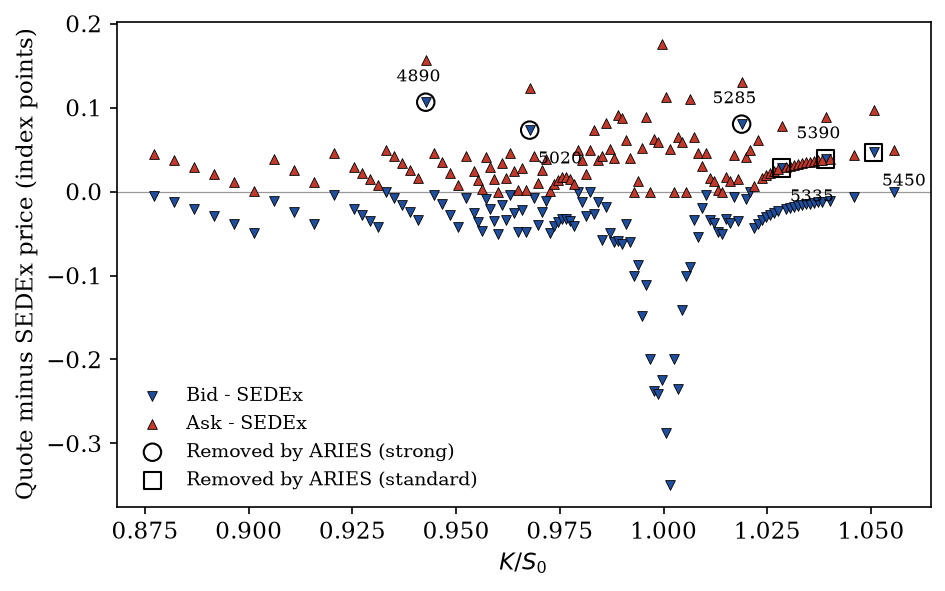
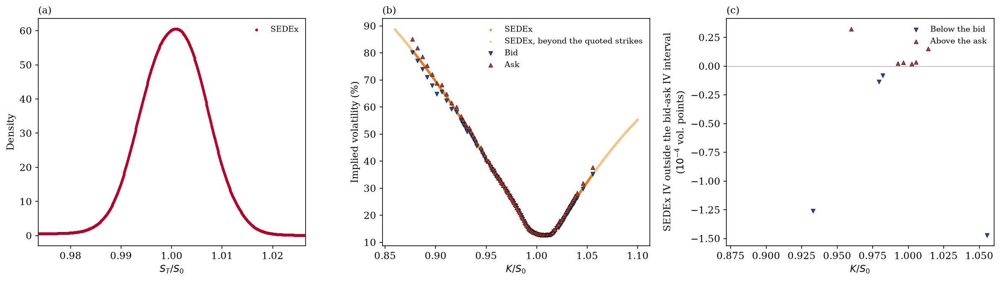

# ARIES and SEDEx

[](https://doi.org/10.5281/zenodo.24591173)

Python implementation of the two procedures introduced in

> A. Wizman, G. Turinici and G. Merran, *From Arbitrage Removal to Density Extraction: A Model-Free Framework for Short-Dated Options*, arXiv preprint [arXiv:2605.22792](https://arxiv.org/abs/2605.22792).

- **ARIES** removes, one at a time, the bid or ask quotes that support a static arbitrage. At each step a linear program looks for an arbitrage portfolio executable at the quoted prices and within the quoted sizes. It covers strong arbitrages (positive cash at inception) and arbitrages with zero cost and a nonnegative payoff that is positive in some state, reported as `strong` and `standard`. The quote removed is the saturated one with the smallest size.
- **SEDEx** extracts a discrete risk-neutral density from the remaining quotes. The density lives on a uniform grid that contains every strike. Its prices lie inside every bid-ask interval, its total mass is one and its mean is the forward. Among such densities, SEDEx selects the one that minimizes a combination of a smoothness term and an entropy term.

The package also contains the steps that precede ARIES in the paper: estimation of the interest rate and dividend yield from put-call parity, conversion of out-of-the-money puts into call quotes, and a check of the semi-static conditions on vertical and butterfly spreads.

## Installation

Python 3.10 or later.

```bash
git clone https://github.com/aaron-wizman/aries-sedex.git
cd aries-sedex
python -m venv .venv
source .venv/bin/activate          # on Windows: .venv\Scripts\activate
pip install -e ".[test]"
```

`requirements.txt` lists the exact versions used to produce the example outputs.

## Input format

One slice (one underlying, one quote time, one expiry) is a table with one row per listed option:

| column        | content                                   |
|---------------|-------------------------------------------|
| `strike`      | strike, in index points                   |
| `option_type` | `C` (call) or `P` (put)                   |
| `bid`, `ask`  | best bid and ask prices, in index points  |
| `bid_size`, `ask_size` | number of contracts at the bid and at the ask |

The spot price and the time to expiry in years are passed separately (`aries_sedex.year_fraction` computes the latter from two timestamps). Liquidity filters, such as a minimum open interest, are assumed to have been applied. Quotes with a zero bid are dropped. Every strike must be a multiple of the exchange strike increment `strike_lattice` (5 index points by default).

## Quick start

```python
from aries_sedex import OptionArbitrageModel, plotting

model = OptionArbitrageModel.from_csv("examples/data/synthetic_1dte.csv", spot=5187.36, maturity=1 / 365)
model.calibrate_forward()        # r and q from put-call parity; or model.set_rates(r, q)
model.build_call_quotes()        # out-of-the-money puts converted into calls
model.detect_arbitrage()         # ARIES
density = model.extract_density()  # SEDEx

print(model.removed_quotes())    # quotes removed by ARIES
density.to_frame(in_index_points=True)   # grid, masses and density
plotting.plot_overview(model)
```

All prices and strikes are normalized by the spot inside the package; `to_frame(in_index_points=True)` and `removed_quotes()` return index points.

## Example: a synthetic 1DTE slice

`examples/data/synthetic_1dte.csv` is a synthetic one-day-to-expiry slice of a fictitious index (spot 5187.36). **It is not market data.** The quotes were generated from a parametric model with exchange-like conventions: a 5-point strike lattice with wider gaps in the wings, a tick of 0.05 below 3.00 and 0.10 above, a minimum bid of 0.05, one-tick spreads in the wings and wider spreads in the money. Six quotes create arbitrages: three strong arbitrages and three arbitrages with zero cost.

```bash
python examples/run_example.py
```

or open `examples/example_1dte.ipynb`. The run takes less than a minute, almost all of it in SEDEx (4,663 grid points). ARIES removes the six quotes in six iterations, after which no semi-static condition is violated:

| iteration | kind     | strike | option | side | price | size |
|-----------|----------|--------|--------|------|-------|------|
| 1 | strong   | 5285 | call | bid | 0.20 | 2 |
| 2 | strong   | 5020 | put  | bid | 0.65 | 3 |
| 3 | strong   | 4890 | put  | bid | 0.35 | 4 |
| 4 | standard | 5450 | call | bid | 0.10 | 7 |
| 5 | standard | 5390 | call | bid | 0.10 | 5 |
| 6 | standard | 5335 | call | bid | 0.10 | 6 |



The SEDEx density, the implied volatility smile (bid, ask and SEDEx, extended beyond the quoted strikes in a lighter color), and the SEDEx implied volatility where it falls outside the bid-ask implied volatility interval (below the bid or above the ask, as in the paper). The latter stays of the order of $10^{-4}$ volatility point, the tolerance of the solver:



## Main parameters

Default values are those of the paper.

| step | parameter | default | meaning |
|------|-----------|---------|---------|
| rates | `alpha` | 0.5 | weight of moneyness against spread in the parity regression |
| rates | `rate_bounds`, `dividend_bounds` | (0, 0.15), (0, 0.10) | bounds on r and q |
| rates | `zero_rate_maturity` | 1/365 | below this maturity, r = q = 0 |
| ARIES | `eps_lp` | 1e-8 | threshold on the optimal value of the linear program |
| ARIES | `eps_cost` | 1e-8 | tolerance on the cost and payoff of a zero-cost arbitrage |
| ARIES | `sat_rtol` | 1e-4 | relative tolerance of the test "quantity equals size" |
| ARIES | `solver`, `solver_opts` | HiGHS interior point, no crossover | any CVXPY linear programming solver |
| SEDEx | `delta` | 0.005 | target mesh `sigma_ATM * sqrt(2 pi T) * delta` |
| SEDEx | `kappa1`, `kappa2` | 1.55, 10 | support: extension beyond the strikes, number of ATM standard deviations |
| SEDEx | `regularization` | `"hybrid"` | `"hybrid"`, `"smoothness"` or `"entropy"` |
| SEDEx | `lambda1`, `lambda2` | 1, rule of the paper | weights of the smoothness and entropy terms |
| SEDEx | `solver`, `retry_opts` | Clarabel, stricter retry | second solve if the first is not optimal or fails the checks |
| SEDEx | `check_ticks` | 0.01 | largest accepted violation of a bid-ask interval, in ticks of `check_tick` = 0.05 |

Keyword arguments of `detect_arbitrage` and `extract_density` are passed to `aries_sedex.aries.aries` and `aries_sedex.sedex.sedex`, whose docstrings describe every option.

## Notes

- **Interest rate and dividend yield.** At very short maturities, put-call parity determines the forward well near the money, but not r and q separately. On the example the estimate is r = 5.04 % and q = 1.98 %, while the data were generated with r = 4.25 % and q = 1.35 %; the forward error is 0.02 index points. ARIES and SEDEx take r and q as inputs: a user who prefers other values, for instance from a rate curve, can call `model.set_rates(r, q)` instead of `calibrate_forward()`.
- **Implied volatilities** are computed with a built-in Black-Scholes-Merton solver (Brent's method on the out-of-the-money price). SEDEx uses one of them, at the first strike at or above the forward, to set the mesh and the support.
- **Solvers.** ARIES needs `highspy` and `cvxpy >= 1.6.5`. SEDEx uses Clarabel, which handles the exponential cone of the entropy term.

## Tests

```bash
pytest                    # fast tests
RUN_SLOW=1 pytest         # also the full run on the example slice
```

## Citation

Please cite the paper below. The software itself is archived on Zenodo: [10.5281/zenodo.24591173](https://doi.org/10.5281/zenodo.24591173) (all versions; version 1.0.0: [10.5281/zenodo.24591174](https://doi.org/10.5281/zenodo.24591174)).

```bibtex
@article{wizman2026arbitrage,
  title   = {From Arbitrage Removal to Density Extraction: A Model-Free Framework for Short-Dated Options},
  author  = {Wizman, Aaron and Turinici, Gabriel and Merran, Gregory},
  journal = {arXiv preprint arXiv:2605.22792},
  year    = {2026}
}
```

## License

The code is released under the MIT licence (`LICENSE`). The synthetic data in `examples/data` are released under the Creative Commons Attribution 4.0 International licence (`LICENSE-CC-BY-4.0`); when you use them, please cite the paper above.
